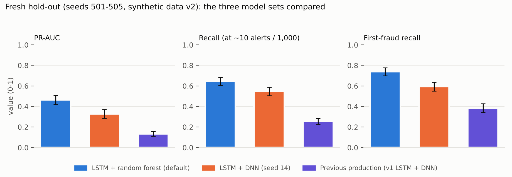

# ML experiment status

Updated in the follow-up pass with Experiment 3 (section 7). Scope: what the repository's machine-learning evidence actually shows after this audit, what was independently re-checked, and what is missing.
**All data are synthetic.** Nothing below describes real-world banking performance.

## 1. Datasets (verified)

| Dataset | What it is | Verified facts |
|---|---|---|
| v1 seed (`data/transactions_with_features.csv`) | 500 synthetic customers; the dashboard's histories and the training data of the `production` model set | 93,913 rows, 819 fraud rows (0.872 %), 60 fraud customers; no NaN/inf; no duplicate ids. **Trivially separable:** `amount_pct_of_avg` alone has ROC-AUC 1.000; the rule "unusual hour AND amount ≥ 188 % of average" gives recall 1.000, precision 0.967 on it. Features were generated by an earlier code version (R-08). Not reproducible from the generator because dates use `datetime.now()` (R-09) |
| v2 (`data/v2`, generator 2.0.1) | deterministic synthetic generator with 7 fraud archetypes, rings, legitimate anomalies (travel, new devices, VPN …) | seed 42 regenerated in this audit (Python 3.13 / pandas 3.0.6) reproduced all five committed SHA-256 hashes. Default: 500 customers, 101,297 transactions, 471 fraud rows (0.465 %), 110 episodes |
| v2 hold-out seeds | fresh datasets generated once for the pre-registered confirmation | 501–505 (5 × 500 customers, 487,368 rows, 2,390 fraud rows, 550 episodes) and 511–515 (new-customer variant, 450,095 rows, 2,693 fraud rows, 632 episodes) |
| Experiment 3 seeds (follow-up) | five new datasets, 1,000 customers each, generator 2.0.1, never used before: validation 9301–9302, test 9303–9305 | 205,612 / 205,622 validation rows (966 / 962 fraud) and 205,069 / 208,565 / 207,243 test rows (959 / 980 / 971 fraud, 220 episodes each); every file matched its manifest SHA-256. All 2,910 test fraud rows have at least 10 earlier transactions. Details and hashes: `experiments/validation_exp3/RESULTS.md` |

## 2. Models and training (as implemented)

* **LSTM** (`lstm_model.py`): input 10 × 9, `Masking → LSTM(64) → Dropout → LSTM(32) → Dropout → Dense(16) → Dense(1, sigmoid)`, 31,905 parameters.
  Target: is the **next** transaction after the 10-transaction window fraudulent; output ×100 = Risk Score. Past-only windows; the current transaction is excluded.
* **Random forest** (default): 200 trees, max depth 12, min leaf 5, no class weighting; inputs = 9 features + Risk Score; trained on **out-of-fold** LSTM scores
  (leakage-safe stacking). Selected by pre-registered protocol "4D v1" among DNN, logistic regression, random forest, histogram gradient boosting.
* **DNN** (previous classifier): `64 → BatchNorm → Dropout → 32 → Dropout → 16 → 1`, 3,585 parameters.
* Cold start (< 10 earlier transactions): LSTM skipped, Risk Score = training mean; first transaction: baseline-relative features set to the training mean.
* Serving: scores are model scores 0–100, capped at 99.9; **no calibration** is applied (calibration appears only as an offline evaluation analysis).
* Split design (`evaluation/split.py`): time-based primary split with whole fraud episodes/rings kept together, customer-group secondary split, thresholds chosen on validation only, seeds fixed, TensorFlow determinism enabled.

## 3. Independent verification performed in this audit

| Check | Result |
|---|---|
| Recompute PR-AUC, ROC-AUC and the confusion matrix of the v2 time-split evaluation from the committed per-row scores | **Exact match** (table below) |
| Internal consistency of the hold-out report: recall = TP/(TP+FN), precision = TP/(TP+FP), FPR = FP/(FP+TN) for the default model | consistent (1,542 / 2,390 = 0.645; 1,542 / 6,527 = 0.236; 4,985 / 484,978 = 0.0103) |
| README headline claims (PR-AUC 0.464 vs 0.328; recall 0.645 vs 0.548) | match `final_holdout_report.json`; gate C1 difference 0.136 = 0.464 − 0.328 |
| Protocol discipline | the selection record states the hold-out did not exist when the decision was written; protocol and dataset hashes are recorded |
| Hold-out re-run | **not performed** (single-use by design; per-row scores not committed) |

*Test period: 21,142 windows, 61 fraud rows (from the committed `scores_time_split.csv.gz`).*

| Model | PR-AUC recomputed | PR-AUC in report | ROC-AUC recomputed | ROC-AUC in report |
|---|---|---|---|---|
| lstm_risk_predictor | 0.1345 | 0.1345 | 0.7407 | 0.7407 |
| dnn_fraud_classifier | 0.1045 | 0.1045 | 0.8993 | 0.8993 |
| amount_hour_rule | 0.0272 | 0.0272 | 0.7296 | 0.7296 |
| logistic_regression | 0.1375 | 0.1375 | 0.8905 | 0.8905 |
| dnn_without_risk_score | 0.1283 | 0.1283 | 0.8965 | 0.8965 |

Observation: on this harder v2 time-split test the PR-AUCs are low (0.03–0.14) and the best of them is logistic regression (0.1375), above the DNN
(0.1045) and the LSTM score alone (0.1345); only **61 fraud rows** are in the test period, so these are very uncertain.

## 4. Fresh hold-out results (verbatim from `final_holdout_report.json`)

**Hold-out seeds 501–505**

*5 fresh datasets, 487,368 transactions, 2,390 fraud transactions, 550 fraud episodes, 550 first-fraud transactions.*

| Model | PR-AUC [95% CI] | ROC-AUC | Recall [95% CI] | Precision | F1 | Legit alerts / 1,000 | First-fraud recall [95% CI] | Episodes detected |
|---|---|---|---|---|---|---|---|---|
| LSTM + random forest (default) | 0.464 [0.419, 0.509] | 0.939 | 0.645 [0.608, 0.683] | 0.236 | 0.346 | 10.23 | 0.738 [0.699, 0.776] | 439 / 550 |
| LSTM + DNN (seed 14) | 0.328 [0.286, 0.371] | 0.929 | 0.548 [0.505, 0.588] | 0.217 | 0.311 | 9.68 | 0.595 [0.550, 0.637] | 386 / 550 |
| Previous production (v1 LSTM + DNN) | 0.133 [0.111, 0.157] | 0.691 | 0.255 [0.228, 0.283] | 0.104 | 0.148 | 10.71 | 0.384 [0.340, 0.427] | 322 / 550 |

**New-customer variant, seeds 511–515**

*5 fresh datasets, 450,095 transactions, 2,693 fraud transactions, 632 fraud episodes, 549 first-fraud transactions.*

| Model | PR-AUC [95% CI] | ROC-AUC | Recall [95% CI] | Precision | F1 | Legit alerts / 1,000 | First-fraud recall [95% CI] | Episodes detected |
|---|---|---|---|---|---|---|---|---|
| LSTM + random forest (default) | 0.490 [0.449, 0.531] | 0.939 | 0.638 [0.603, 0.675] | 0.287 | 0.396 | 9.50 | 0.738 [0.696, 0.776] | 492 / 632 |
| LSTM + DNN (seed 14) | 0.365 [0.323, 0.408] | 0.928 | 0.533 [0.495, 0.572] | 0.266 | 0.355 | 8.78 | 0.599 [0.555, 0.642] | 440 / 632 |
| Previous production (v1 LSTM + DNN) | 0.163 [0.138, 0.188] | 0.705 | 0.269 [0.241, 0.297] | 0.133 | 0.178 | 10.49 | 0.399 [0.355, 0.443] | 366 / 632 |

Reading the evidence: on the fresh synthetic hold-outs the LSTM + random forest is clearly better than the DNN variants under the project's own metrics, at about 10
alerts per 1,000 legitimate transactions (the validation-chosen budget). Its precision is about 0.24, meaning roughly three of four alerts are false at that budget.
For the default model, first-fraud recall (0.738) is higher than recall over all fraud transactions (0.645); they use different denominators (550 first transactions vs 2,390 fraud rows), and this audit did not analyse why. The project's earlier finding stands: the LSTM score does not warn *before* a first fraud
(`docs/EVALUATION.md`), and on v2 the DNN-only variant detects first frauds at least as well as the LSTM variant (`docs/step4c3e-stage-c-final-evaluation.md`).

## 5. What the evidence does and does not support

* **Supported:** among the compared designs, LSTM + random forest ranks fraud better on fresh, same-generator synthetic data; metrics are computed with
  validation-chosen thresholds and group-level bootstrap intervals; the pipeline is leakage-controlled by design (past-only features, out-of-fold stacking, whole-episode splits).
* **Added by Experiment 3 (synthetic, fresh seeds):** the LSTM input adds measurable value over the same random forest without it; the Behavioral Similarity Score separates fraud
  from legitimate rows on this generator but adds no measurable information beyond the classifier; the forest's score is close to calibrated on this generator.
* **Not supported:** any statement about real banking data; calibrated probabilities *outside this generator*; early warning before a first fraud; a benefit of the Behavioral
  Similarity Score beyond explanation (it is a heuristic with equal feature weights; R-05 is fixed, R-14 remains); generalisation to a different data generator (training,
  hold-outs and Experiment 3 all use the v2 generator and its assumptions).

## 6. Missing evidence and a plan to obtain it

| Gap | Why it matters | Proposed procedure (nothing below has been run) |
|---|---|---|
| Real or independently generated data | all conclusions share one generator's assumptions | evaluate on an independent generator and, if licensing and access allow, a public fraud dataset after checking schema, labels, time information; report separately from synthetic results. A design for this exists in `experiments/sequence_early_detection/PROTOCOL_DRAFT_v1.md` |
| Calibration | scores are described as uncalibrated, but alert bands imply meaning | **Measured in Experiment 3** (section 7.2) on synthetic data; independent data is still needed before calling the score a probability; alert bands (R-02) are still a decision |
| Small v2 time-split test (61 fraud rows) | wide uncertainty | rely on the 550-episode hold-outs; extend with additional fresh seeds if a claim depends on small differences |
| Behavioral Similarity Score | was never evaluated | **Evaluated in Experiment 3** (section 7.1); a learned weighting remains untried |
| First-fraud / early warning | the stated research hypothesis is not supported | see `experiments/sequence_early_detection/` (protocol drafted, not run) |
| Re-run of the hold-out | single-use by design | a new fresh seed set under a new pre-registered protocol, not a re-score of 501–505 |

## 7. Experiment 3 — similarity, calibration and ablations on fresh synthetic seeds (follow-up pass)

Protocol `experiments/validation_exp3/PROTOCOL.md` (commits `b58fa52`, amendment `e81b356`) was committed **before** any of its data was generated (data generation started after the amendment). Test seeds 9303–9305
(620,877 rows, 2,910 fraud, 660 episodes) were used once for the numbers below; everything fitted or chosen (calibrators, the similarity combination, alert cut-offs) used validation seeds 9301–9302 only.
Intervals are 95 % customer-component bootstrap (2,000 replicates, seed 9101). Full tables, hashes and configuration: `experiments/validation_exp3/RESULTS.md` and `results/*.json`.
The numbers were recomputed independently from the per-row scores with scikit-learn (51 of 51 checks agree) and a second complete run (re-scoring and re-analysis) gave identical results.
Population: rows with at least 10 earlier transactions (590,877 rows, all the fraud) unless stated. **All of this is in-distribution synthetic evidence.**

### 7.1 Behavioral Similarity Score (deviation = 100 − similarity)

| Question | Result |
|---|---|
| Does it separate fraud from legitimate rows? | Yes on this data: ROC-AUC 0.866 [0.852, 0.878], PR-AUC 0.069 [0.059, 0.081] (prevalence 0.0049); median deviation 11.5 (legitimate) vs 30.2 (fraud). Direction as intuition suggests (more deviation, more fraud) — it was not assumed, it was measured |
| For which fraud types? | high-value single 0.989, ring 0.972, card testing 0.948, device takeover 0.929, account takeover 0.895, stolen card online 0.763, "normal-looking" fraud 0.618 (each against all legitimate rows) |
| Does it add information beyond the classifier? | **Not shown.** A logistic combination of the classifier score and the deviation (fitted on validation) changes PR-AUC by +0.0011 [−0.0002, +0.0023] and ROC-AUC by −0.0002 [−0.0004, −0.0000]; recall at the frozen cut-off falls by 0.004 [−0.008, −0.001]. Within fraud rows the deviation is strongly correlated with the classifier score (Spearman 0.77) |
| Effect of history length | ROC-AUC 0.775 [0.672, 0.880] at 10–29 earlier transactions (83 fraud rows), 0.861 [0.839, 0.880] at 30–99, 0.880 [0.864, 0.895] at 100 or more: lower at short histories, but the first interval is wide and nearly touches the others |
| Zero-variance features | in 94.5 % of scored rows at least one of the nine features has zero standard deviation in the customer's history, and the formula replaces that standard deviation by 1 (R-14). Flooring the standard deviation at 0.5 instead made it worse (ROC-AUC −0.0065, PR-AUC −0.0254, both intervals exclude 0), so no variant is proposed |
| Circularity | Fraud in this generator departs from the generator's own customer baselines on the same nine features, so the result shows that the score reflects the generator's rules, not that it detects real fraud |
| Not testable here | fraud on fewer than 10 earlier transactions (none exists in these datasets); the score is withheld there by design (R-05) |

Reading: it is a reasonable *explanation* of how unusual a purchase is for the customer; it is not a second, independent detector.

### 7.2 Calibration of the Fraud Score (default model)

On the pooled test rows (all rows): Brier 0.003295, log loss 0.01609, calibration slope 1.10 and intercept 0.41, ECE 0.0008 (equal width) / 0.0005 (equal mass). Mean predicted 0.0044 vs observed fraud rate 0.0047.
In the top bin of 15 equal-mass bins (41,391 rows) the mean score is 0.051 and the observed fraud rate 0.056; the other 14 bins hold scores below 0.005. So **on this generator the score is already close to a probability and slightly under-confident at the top**.

| Calibrator (fitted on validation only) | Brier | Log loss | ECE (equal mass) | Brier difference vs uncalibrated [95 % CI] | Better in each test seed |
|---|---|---|---|---|---|
| none | 0.003295 | 0.01609 | 0.00049 | – | – |
| sigmoid (Platt) | 0.003250 | 0.01601 | 0.00021 | −0.000044 [−0.000061, −0.000028] | yes |
| isotonic | 0.003159 | 0.01575 | 0.00016 | −0.000135 [−0.000169, −0.000101] | yes |

By the protocol's rule both calibrators are "useful" (lower Brier and log loss, intervals exclude 0, every test seed), but the gains are small in absolute terms (isotonic lowers the Brier score by 4 % of its value) and isotonic collapses the score to 155 distinct values (ROC-AUC 0.9389 → 0.9379, PR-AUC 0.4766 → 0.4621).
The serving score is unchanged and is not called a probability. This is an in-generator result: the base rate (about 0.47 %) and customer mix are the generator's; on real data the calibration must be re-measured.

### 7.3 Baselines and ablations (identical rows, cut-off fixed on validation at 1 % false-positive rate)

| Model | PR-AUC [95 % CI] | ROC-AUC | Recall | Precision | Legit. alerts per 1,000 legit. |
|---|---|---|---|---|---|
| LSTM → random forest (default) | 0.507 [0.466, 0.547] | 0.941 | 0.642 | 0.251 | 9.48 |
| random forest without the LSTM input (re-trained here) | 0.424 [0.383, 0.464] | 0.910 | 0.560 | 0.224 | 9.62 |
| LSTM → DNN | 0.373 [0.331, 0.413] | 0.932 | 0.558 | 0.220 | 9.80 |
| logistic regression (re-trained here) | 0.289 [0.253, 0.325] | 0.891 | 0.411 | 0.173 | 9.72 |
| DNN only (no LSTM) | 0.209 [0.177, 0.242] | 0.893 | 0.405 | 0.173 | 9.57 |
| production v1 (different training data) | 0.172 [0.147, 0.198] | 0.709 | 0.279 | 0.125 | 9.71 |
| similarity deviation alone | 0.069 [0.059, 0.081] | 0.866 | 0.238 | 0.102 | 10.39 |
| amount-and-hour rule | 0.032 [0.028, 0.038] | 0.666 | 0.201 | 0.089 | 10.23 |

Paired differences: default − random forest without LSTM: PR-AUC +0.083 [0.069, 0.096], recall +0.081 [0.066, 0.096] at an unchanged false-alert rate, so **the LSTM input adds detectable value over the same forest** on this generator; default − (LSTM → DNN): PR-AUC +0.134 [0.119, 0.152].
At about 9.5 false alerts per 1,000 legitimate transactions the default model has precision 0.25: three of four alerts are false. Confusion matrices and first-fraud recall are in `RESULTS.md`.
The re-trained baselines are the repository's recipe without tuning; they are comparators, not optimised competitors.

**Cold-start rows** (30,000 test rows with fewer than 10 earlier transactions, all legitimate): at the same cut-offs the default model alerts on 5.9 % of them, the production v1 model 6.4 %, the re-trained forest without LSTM 16.5 %, LSTM → DNN 2.6 % and DNN only 1.8 %. This is the new-customer weakness the project documents; Experiment 3 measures it and tests no remedy.

### 7.4 Comparison with the earlier hold-out (valid only in part)

On the earlier hold-out (seeds 501–505, section 4) the default model had PR-AUC 0.464 [0.419, 0.509], LSTM → DNN 0.328 and production 0.133. In Experiment 3: 0.507, 0.373 and 0.172. The ordering is the same and the intervals for the default model overlap.
Only the ranking metrics are comparable: datasets are different draws with twice as many customers and the alert cut-offs come from different rules (the earlier frozen policy cut-off versus 1 % validation false-positive rate), so alert counts and recall are not compared. It is a consistency check on one generator, not an independent confirmation.

### 7.5 Limits

* Same generator as training: fraud patterns, features and customer behaviour are the authors' assumptions (`experiments/validation_exp3/INDEPENDENT_VALIDATION_STATUS.md`).
* Three test datasets are independent draws, not independent worlds; the calibration assumes the same base rate; there is no fraud on short histories in these data.
* The re-trained baselines were fitted once; no seeds of the baselines' own training were varied.

## 8. Alert levels (R-02 pass)

The Fraud Score is the random forest's `predict_proba` × 100 (capped at 99.9): a model score, not a calibrated probability (hold-out reliability: scores averaging 0.34, 0.45 and 0.55 correspond to observed fraud rates of 0.59, 0.67 and 0.85). Serving used the earlier DNN's bands 25/50/80, under which 62.1 % of fraud on the fresh hold-out showed as "Low Risk";
the evaluation always used the validation-period cut-offs. Since the R-02 pass the default model set's levels are those cut-offs (Low < 4.39 ≤ Medium < 26.23 ≤ Critical). Measured behaviour of the tiers: alert cut-off recall 0.645, precision 0.236, 10.2 false alerts per 1,000 legitimate (hold-out 501–505); critical cut-off recall 0.364, precision 0.666, 0.9 per 1,000;
re-check on Experiment 3's seeds (not used to choose them): 0.644 / 0.248 and 0.383 / 0.737. Details, options and impact: `docs/R-02-alert-score-decision.md`. No protocol, hold-out, threshold or model file was changed; calibration remains outside serving.
